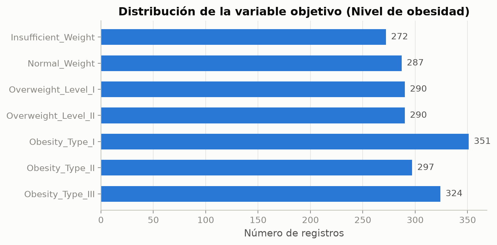
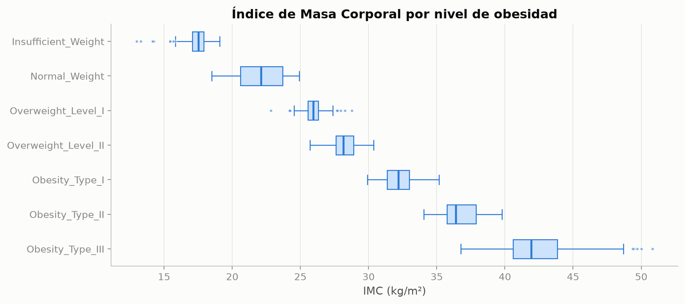
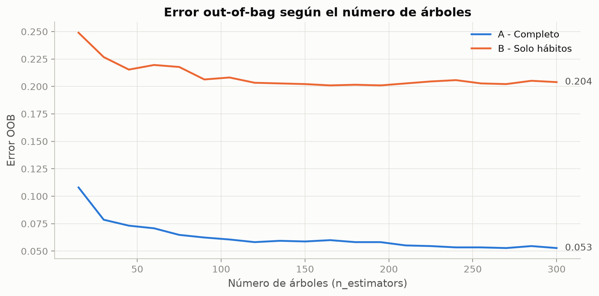
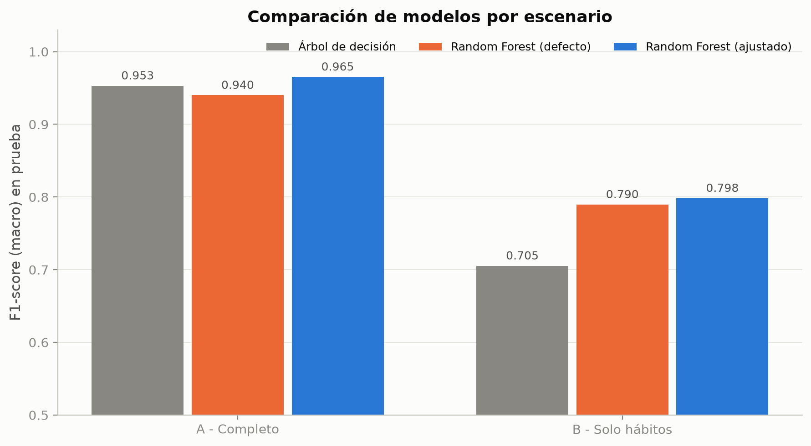
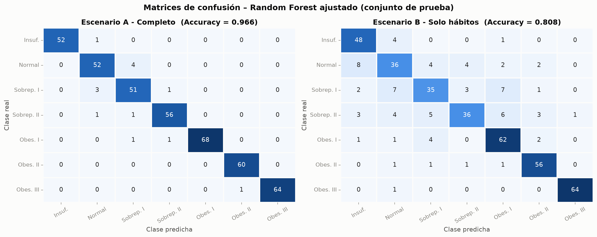
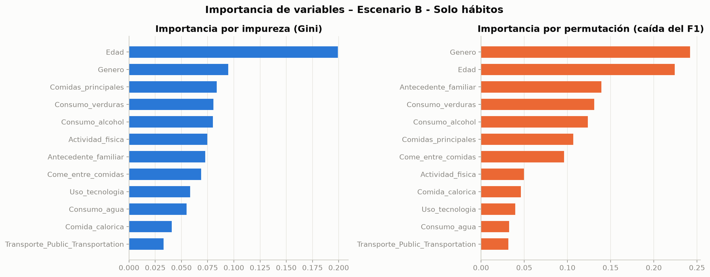

# Predicción del nivel de obesidad con Random Forest

Proyecto final de **Inteligencia Artificial** (2026). Se construye un sistema inteligente que clasifica a una persona en uno de **7 niveles de peso** a partir de sus hábitos de alimentación, su actividad física y algunos datos demográficos, usando el algoritmo **Random Forest**.

**Integrantes:** _(agregar nombres)_

---

## Problema

La obesidad está asociada a enfermedades como la diabetes tipo 2, la hipertensión y las enfermedades cardiovasculares, y es uno de los principales problemas de salud pública en Latinoamérica. Detectar a tiempo qué personas están en riesgo **a partir de sus hábitos de vida** permite enfocar campañas de prevención.

El modelo predice uno de estos niveles:

| Nivel (dataset) | En español | IMC según la OMS |
|---|---|---|
| `Insufficient_Weight` | Peso insuficiente | < 18,5 |
| `Normal_Weight` | Peso normal | 18,5 – 24,9 |
| `Overweight_Level_I` | Sobrepeso nivel I | 25,0 – 29,9 |
| `Overweight_Level_II` | Sobrepeso nivel II | 25,0 – 29,9 |
| `Obesity_Type_I` | Obesidad tipo I | 30,0 – 34,9 |
| `Obesity_Type_II` | Obesidad tipo II | 35,0 – 39,9 |
| `Obesity_Type_III` | Obesidad tipo III | ≥ 40 |

La OMS no divide el sobrepeso en dos niveles; esa división la hicieron los autores del dataset.

## Dataset

*Estimation of obesity levels based on eating habits and physical condition*, del [UCI Machine Learning Repository (ID 544)](https://archive.ics.uci.edu/dataset/544).

- 2.111 registros de personas de **Colombia, México y Perú**, con 16 variables de entrada y 1 variable objetivo (`NObeyesdad`).
- El 23 % de los datos se recolectó con una encuesta web y el **77 % es sintético**: los autores lo generaron con SMOTE para balancear las clases.
- Variables: sexo, edad, estatura, peso, antecedente familiar de sobrepeso, consumo de comida calórica, de verduras, de agua y de alcohol, número de comidas principales, comer entre comidas, fumar, contar calorías, actividad física, tiempo frente a pantallas y medio de transporte.

> Palechor, F. M., & De la Hoz Manotas, A. (2019). *Dataset for estimation of obesity levels based on eating habits and physical condition in individuals from Colombia, Peru and Mexico*. Data in Brief, 25, 104344.

## Método: Random Forest

Random Forest es un método de **ensamble** que combina muchos árboles de decisión:

1. **Bootstrap (bagging):** cada árbol se entrena con una muestra aleatoria con reemplazo de los datos. Cerca del 37 % de los registros queda fuera de cada árbol (muestras *out-of-bag*, OOB) y sirve para estimar el error sin usar el conjunto de prueba.
2. **Selección aleatoria de variables:** en cada división el árbol solo puede escoger entre un subconjunto aleatorio de variables (`max_features`), lo que hace que los árboles sean poco parecidos entre sí.
3. **Votación:** cada árbol vota por una clase y gana la más votada. La proporción de votos es la probabilidad de cada clase.

Un árbol solo tiende a sobreajustar; al promediar cientos de árboles distintos se **reduce la varianza** del modelo.

## Dos escenarios

| Escenario | Variables | Pregunta que responde |
|---|---|---|
| **A – Completo** | Todas, incluidas estatura y peso | ¿Qué tan bien clasifica el modelo con toda la información? |
| **B – Solo hábitos** | Todas excepto estatura y peso | ¿Se puede predecir el nivel de obesidad solo con los hábitos de vida? |

La clase objetivo se definió con el IMC (peso / estatura²). Con peso y estatura el modelo casi reconstruye esa fórmula; el escenario B mide si los hábitos tienen poder predictivo por sí solos, que es lo útil para prevención.

## Proceso (notebook `RandomForest.ipynb`)

1. **Carga y comprensión de los datos:** diccionario de variables, tipos, estadísticas y balance de clases (cada una de las 7 clases tiene entre el 12,9 % y el 16,6 % de los registros).
2. **Limpieza y preprocesamiento:**
   - Columnas renombradas al español.
   - Sin valores faltantes.
   - Redondeo de las respuestas ordinales y de la edad, que traían decimales por la generación sintética (por ejemplo, 2,45 en consumo de verduras).
   - Eliminación de 27 registros duplicados (quedan 2.084).
   - Agrupación de categorías con muy pocos registros: `Always` en consumo de alcohol (1 registro) se une a `Frequently`, y bicicleta y moto se unen en transporte.
   - Atípicos revisados con el criterio IQR y conservados: son valores reales y Random Forest es robusto frente a ellos.
   - Codificación: binarias a 0/1, ordinales respetando su orden y *one-hot* para el transporte. Random Forest no necesita escalar las variables.
   - Partición estratificada 80 % entrenamiento / 20 % prueba (semilla 42).
3. **Entrenamiento:**
   - Árbol de decisión como línea base.
   - Random Forest con parámetros por defecto.
   - Curva de error OOB según el número de árboles.
   - Ajuste de hiperparámetros con `RandomizedSearchCV`: 60 combinaciones, validación cruzada estratificada de 5 particiones, optimizando el F1-macro.
4. **Evaluación:** Accuracy y F1-score (macro), F1 por clase, matrices de confusión, validación cruzada de 10 particiones e importancia de variables (Gini y por permutación).
5. **Guardado:** los modelos finales se guardan con `pickle` para el despliegue.

## Resultados

Conjunto de prueba (417 personas que el modelo no vio durante el entrenamiento):

| Escenario | Modelo | Accuracy | F1-score (macro) |
|---|---|---|---|
| A – Completo | Árbol de decisión | 0,954 | 0,953 |
| A – Completo | **Random Forest ajustado** | **0,966** | **0,965** |
| B – Solo hábitos | Árbol de decisión | 0,715 | 0,705 |
| B – Solo hábitos | **Random Forest ajustado** | **0,808** | **0,798** |

Validación cruzada de 10 particiones (F1-macro, media ± desviación):

- Escenario A: Random Forest **0,968 ± 0,016**; árbol de decisión 0,942 ± 0,021.
- Escenario B: Random Forest **0,803 ± 0,025**; árbol de decisión 0,734 ± 0,029.

**Hallazgos principales:**

- Random Forest supera al árbol de decisión en los dos escenarios. En el B la mejora es de unos **9 puntos de F1**: el árbol solo sobreajusta (98,6 % de Accuracy en entrenamiento frente a 71,5 % en prueba).
- Solo con hábitos, el modelo acierta el **80,8 %** de las veces entre 7 clases (al azar sería cerca del 14 %). Las variables más influyentes son la edad, el antecedente familiar, el consumo de verduras, el alcohol y el número de comidas.
- La mayoría de los errores del escenario B son entre niveles vecinos (peso normal, sobrepeso I y sobrepeso II).
- `max_features` es el hiperparámetro más sensible, y el error OOB se estabiliza alrededor de los 100–150 árboles.

### Figuras

| | |
|---|---|
|  |  |
|  |  |





Todas las figuras están en la carpeta [`figuras/`](figuras/) en alta resolución, listas para el artículo y las diapositivas.

## Estructura del repositorio

```
├── RandomForest.ipynb                           # Limpieza, entrenamiento y evaluación
├── ObesityDataSet_raw_and_data_sinthetic.csv    # Dataset original (UCI)
├── figuras/                                     # Gráficas generadas por el notebook
└── modelos/
    ├── rf_escenario_A.pkl                       # Random Forest con peso y estatura
    └── rf_escenario_B.pkl                       # Random Forest solo con hábitos
```

## Cómo ejecutarlo

Requiere Python 3.12.

```bash
pip install pandas numpy scikit-learn==1.9.0 matplotlib seaborn jupyter
jupyter notebook RandomForest.ipynb
```

Ejecuta todas las celdas en orden (*Run All*). La búsqueda de hiperparámetros tarda unos 3 minutos. La semilla está fija (`SEMILLA = 42`), así que los resultados se reproducen exactamente.

## Usar los modelos guardados

Cada `.pkl` guarda un diccionario con el modelo, el orden de las columnas, las clases, los mapeos de codificación y las métricas de prueba:

```python
import pickle

with open("modelos/rf_escenario_B.pkl", "rb") as f:
    paquete = pickle.load(f)

modelo = paquete["modelo"]          # RandomForestClassifier entrenado
columnas = paquete["columnas"]      # orden exacto de las variables de entrada
print(paquete["metricas_prueba"])   # Accuracy y F1 en el conjunto de prueba
```

> Los `.pkl` deben cargarse con la misma versión de scikit-learn con la que se entrenaron (**1.9.0**), y solo desde fuentes confiables, porque al cargarlos se puede ejecutar código.

## Despliegue

El modelo se desplegó en **Balánzate**, una aplicación web en un repositorio aparte:

- **API en Python (FastAPI):** carga los `.pkl`, aplica la misma limpieza y codificación del notebook y devuelve el nivel predicho y la probabilidad de cada uno de los 7 niveles.
- **Página en Next.js:** cuestionario de 14 preguntas. Si la persona escribe su estatura y su peso se usa el modelo A; si no, el modelo B.
- Publicada en Vercel.

## Consideraciones éticas y limitaciones

- El **77 % de los datos es sintético**, y eso introduce artefactos. Por ejemplo, *Obesity_Type_II* es casi 100 % hombres y *Obesity_Type_III* 100 % mujeres, así que el modelo le da al sexo más importancia de la que tendría con datos reales. Los resultados del escenario B en esas clases son optimistas.
- La predicción es una **estimación estadística, no un diagnóstico médico**, y no reemplaza la valoración de un profesional de la salud.
- Hay riesgo de **estigmatización** por el peso: el sistema debe presentarse como una herramienta de prevención y no como un juicio sobre la persona.
- **Privacidad:** los datos de salud y de hábitos son sensibles. La aplicación desplegada no guarda las respuestas.

## Referencias

- Palechor, F. M., & De la Hoz Manotas, A. (2019). Dataset for estimation of obesity levels based on eating habits and physical condition in individuals from Colombia, Peru and Mexico. *Data in Brief*, 25, 104344.
- Breiman, L. (2001). Random Forests. *Machine Learning*, 45(1), 5–32.
- Pedregosa, F. et al. (2011). Scikit-learn: Machine Learning in Python. *Journal of Machine Learning Research*, 12, 2825–2830.
